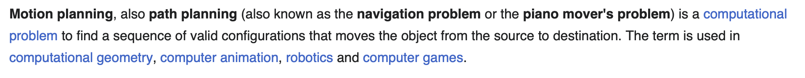
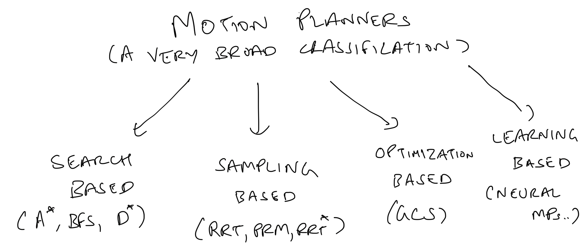

  My First Post     

[Akhil's Blogs](../index.html)
==============================

The Path Not Taken: Why Motion Planning Is Crucial
=============

_Date: 2025-05-05_

* * *

Being my first blog post, I wanted to start of with a topic that was the very reason why I fell in love with robotics...

I also felt the need to be able to convey my research (or something I try to do in my spare time) a bit more effectively, hence this blogging format. A bit of HTML,CSS and embedded code via Deepnote...

A lot of the concepts, ideas and algorithms have been inspired from //cite Lavalle, //cite Redrake text and //cite Boyd..

Here is some **bold text** and some _italic text_.

**A brief introduction..**

Wikipedia defines Motion Planning as shown below, 

Although the above definition seems to be mostly correct and simplistic, however one must clarify beforehand that source (and destination), needn't necessarily be points in the real spaces, $\mathbb{R}^{2}, \mathbb{R}^{3}$. One could perform motion planning for higher dimensions and also for different spaces (for example the joint spaces in manipulators, belief spaces for SLAM etc..)

For this blog, I kind of wanted to go over the brief categories of different algorithms used in motion planning and draw a distinction between each of them.

As far as my understanding goes, motion planners could be broadly divided into 4 types.. (excuse the Notes app picture..)

